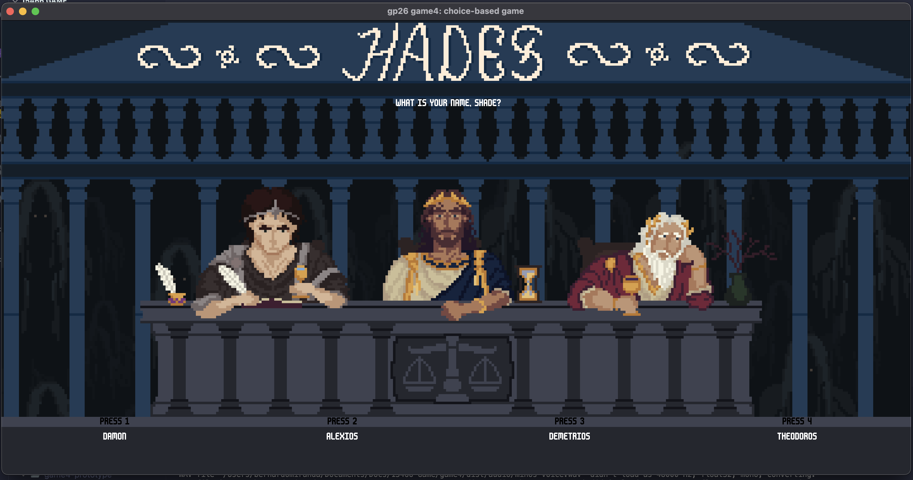

# THE THREE JUDGES

Author: Bernardo Miranda

Design: After death, you stand before the three judges of the afterlife. They decide where you will spend the rest of eternity as a shade. You must answer their questions and not tell contradictions or upset them in order to get the best outcome in your afterlife.

Text Drawing: (TODO: how does the text drawing in this game work? Is text precomputed? Rendered at runtime? What files or utilities are involved?)

First, we actually take the bit representation of what we need to write and give it to Harfbuzz, along with the font. It gives us back a list of the glyphs, in order, including the glyph index and how far you move between glyphs.
Then, we check if this shape has already been drawn. If so, then just grab it out the cache. Otherwise, we have FreeType rasterize the shape once and put it in the cache of glyphs.
Each glyph is drawn as two triangles (that make a rectangle) then put a texture on that (using coverage map). Also, alpha blending is on to make transparent things transparent.
Then, we expand into 4 bytes to make it more than just coverage map (expand into r, g, b, alpha). Then we use OpenGL to load the textures and get them ready to be drawn on the screen, using GL_NEAREST to make it not blur
Then, for the cool part that makes the text move slow like Undertale, we have an array of glyphs and we walk from left to right, placing one at a time with certain interval of time between each placement, centered on the location we chose. Pretty much, for the typewriter effect like undertale, the entire line is redrawn but with one extra glyph at 30 glyphs per second.

Also, before handling any lines, we split text into an array of strings

Choices: (TODO: how does the game store choices and narrative? How are they authored? Anything nifty you want to point out?)
I'll be honest, this is probably the least technically intuitive thing that I made. I spend a LONG time hardcoding all the questions into a question file with all the answers. I have a markdown file called plan.md where I planned out the entire game, and then I copy and pasted each question and the answer banks for each question into the questions.hpp file I have.
For each question, we include which judge can ask the question, and how many answers there are, as well as all of the answer bank.
For each answer to a question, there is a Score array, a Mood array, a state change array, and a change_to array. The score array is added to the player's score for each judge (the array is length 3 for each judge). The mood is also judge-based and determines how well the scores multiply (so a judge with a higher mood will gain more points from a good answer, and a judge with a poor mood will gain less points from a good answer). We track certain player states (such as their occupation, their family, et cetera) to be able to truly track the player's decisions when they answer and find any contradictions in answers. This is all stored in each answer in teh questions.hpp file.
In the playmode.cpp file, we store the different states. We have phase determining which game phase we are in (naming, intro, asking, answering, reacting, choosing, game over). The naming and intro only happen once, at the start. The asking, answering, reacting is teh main gameplay loop. The choosing is after a certain number of questions, we ask the player if they want to continue answering questions or if they want their results, and they can choose whichever (but answering more questions makes likelihood of a contradiction higher). Game over is the ending the player gets. The timer variable is a variable used to see how far we are into each state. The used array is to amke sure we dont repeat questions in a run. The claims array is the contradictions array I was talking about, its the different claims the player made while playing (so answering "I have one child" is a claim that you have one child).
Picking a question is uniformly random. Pick four answers from a random start in the answer bank.
When the player answers, we apply the scoring then apply the claims. If there is a contradiction, we have a little contradiction text thingh appen. If the player triggers a secret ending, then we jump to the game over state. Choosing the endings is either by a hidden trigger (for 4 of the endings) or calculated by your final score. (added judge scores divided by total answers).

Screen Shot:

How To Play:

Press 1, 2, 3, 4 to choose an answer. After reaching an ending, press R to restart.

You shouldn't upset the 3 judges with your answers. Each of them have a personality and certain background details that might upset them. They are Rhadamanthys, Minos, and Aeacus (in order from left to right). I planned on making a little guidebook thing to inform the player of their likes and dislikes, but I ran out of time since making the text rendering pathway was way harder than I thought it would be.

There are certain answers that can contradict, and therefore the judges can catch you in a lie. For example, if you answer "my only son" in one question and then "my three children" in the other, the judges will catch that contradiction and jot it down. Your final score is calculated by how much the judges like you (according to your answers) and points are taken away for contradictions.

They all also have a special ending if you answer incorrectly to their judge-specific questions. There is also an ending where you meet Hades if you answer and lie about Hades in his house.

If you want my favorite ending, keep answering until you find an answer about Hades (something along the lines of saying that you are Hades' son). Answer with that.

Sources: (https://managore.itch.io/m6x11)

This game was built with [NEST](NEST.md).
